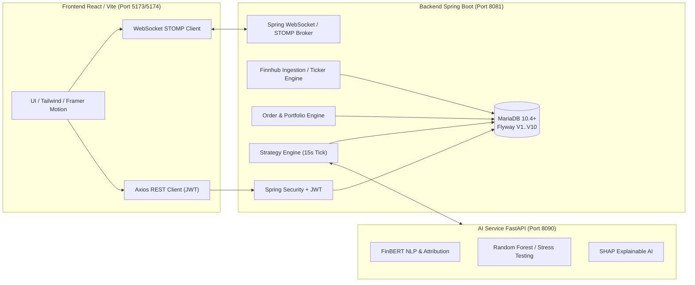
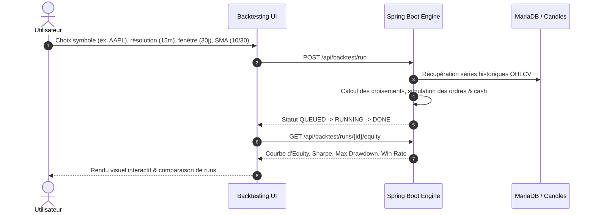

# MARKET SIMULATOR — Guide Exhaustif du Design & Manuel d'Utilisation

> **Plateforme de Trading Algorithmique, Finance Quantitative & Intelligence Artificielle du Risque**  
> *Projet d'Ingénierie — 5ème Année*

---

## Sommaire
1. [Vision Globale & Architecture](#1-vision-globale--architecture)
2. [Philosophie du Design & Motion System](#2-philosophie-du-design--motion-system)
3. [Authentification & Accès Salle de Marché](#3-authentification--accès-salle-de-marché)
4. [Terminal Live & Paper Trading (Module Principal)](#4-terminal-live--paper-trading-module-principal)
5. [Graphique Plein Écran & Boîte à Outils de Trading](#5-graphique-plein-écran--boîte-à-outils-de-trading)
6. [Portefeuille & Gestion des Positions](#6-portefeuille--gestion-des-positions)
7. [Backtesting Quantitatif & Analyse de Performance](#7-backtesting-quantitatif--analyse-de-performance)
8. [Strategy Lab & Agents Autonomes (Auto-Trading)](#8-strategy-lab--agents-autonomes-auto-trading)
9. [Intelligence Actualités & Sentiment FinBERT (NLP/XAI)](#9-intelligence-actualités--sentiment-finbert-nlpxai)
10. [Stress Testing Bancaire & Explainable AI (SHAP)](#10-stress-testing-bancaire--explainable-ai-shap)
11. [Raccourcis & Navigation Rapide (Command Palette)](#11-raccourcis--navigation-rapide-command-palette)

---

## 1. Vision Globale & Architecture

**Market Simulator** est un terminal institutionnel conçu pour reproduire fidèlement l'environnement d'une salle de marché moderne : trading d'actions US et de cryptomonnaies sur cours réels, contrôle mathématique du risque (VaR 95%), modélisation quantitative, intelligence artificielle générative et prédictive (FinBERT, Random Forest, SHAP).



---

## 2. Philosophie du Design & Motion System

### Palette Chromatique Haute Précision
L'interface repose sur une ambiance sombre institutionnelle pensée pour de longues sessions d'analyse sans fatigue visuelle :
- **Surfaces & Fonds** :
  - Fond maître : `Noir Minuit` (`#070B14`)
  - Panneaux de travail (*Workstation Panels*) : `#0B1220` et `#101A2B` avec bordures subtiles (`rgba(148, 163, 184, 0.12)`)
  - Cartes d'action & tiroirs élevés : `#142035` avec halos doux (*ambient glow*)
- **Couleurs d'Accréditation Financière** :
  - **Bullish / Achat** : Vert Émeraude (`#22C55E` / `#34D399`)
  - **Bearish / Vente** : Rose Rubis institutionnel (`#EF4444` / `#F43F5E`)
  - **Terminal / Exécution** : Bleu Cyan Céleste (`#38BDF8` / `#0284C7`)
  - **Moyennes & Alertes** : Ambre Or (`#F59E0B` / `#FBBF24`)
  - **Intelligence Artificielle & NLP** : Violet Quantum (`#8B5CF6` / `#A78BFA`)

### Système de Logos d'Actifs (`<AssetLogo />`)
Chaque actif dispose de son logo officiel en haute définition :
- **Cryptos** : logos vectoriels / HD officiels via CDN spécialisés (`BTC`, `ETH`, `SOL`, `XRP`, `BNB`, `AVAX`, `DOGE`, etc.).
- **Actions US** : logos d'entreprises vectoriels et favicons haute résolution (`AAPL`, `MSFT`, `NVDA`, `TSLA`, `AMZN`, `GOOGL`, etc.).
- **Fallback Brand Color** : badge monogramme stylisé reprenant la signature couleur officielle de l'actif si le réseau est indisponible.

### Motion Design & Transitions de Page
- **Orbital Loader Quantitatif** : transition fluide d'environ 900 ms entre les pages avec double anneau orbital et icône contextuelle de section.
- **Micro-Interactions** : pulsation temps réel des flux (`LivePulseDot`), surbrillance des cours en hausse/baisse, tracé SVG animé des lignes de tendance.

---

## 3. Authentification & Accès Salle de Marché

### Écran de Connexion & Inscription
- **Chemin** : `/login` et `/register`
- **Atmosphère** : chandeliers japonais animés en arrière-plan, carte de verre biseautée (*glassmorphism*), métriques temps réel simulées.
- **Séquence Cinématique** :
  1. Validation des identifiants via Spring Security JWT.
  2. Transition animée de synchronisation des flux STOMP et déchiffrement de session.
  3. Révélation dynamique du Terminal Live.

> [!TIP]
> **Identifiants de démonstration par défaut** :
> - Email : `trader@example.com`
> - Mot de passe : `password123`  
> *(Ou créez votre propre profil en 2 secondes via "Créer un compte")*

---

## 4. Terminal Live & Paper Trading (Module Principal)

Le **Terminal Live** (`/app`) est le centre de commande de vos opérations de marché.

```
┌──────────────────────────────────────────────────────────────────────────────────┐
│ Ticker Tape Défilant (Logos + Prix Live + Variations % + Indicateur de Pulsation) │
├──────────────────────────────────────────────────────────────────────────────────┤
│ 4 StatCards : Equity Totale · PnL Global · VaR 95% du Risque · Ticks Ingestion    │
├──────────────────────────────────────────────────────────────────────────────────┤
│ Watchlist Horizontale Défilante (Cartes d'Actifs + Mini-Sparklines + Buy/Sell)   │
├──────────────────────────────────────────┬───────────────────────────────────────┤
│                                          │ Ticket d'Exécution Rapide (Logo + $)  │
│ Graphique Interactif (TradingViewChart)  │                                       │
│ · Chandeliers / Aire                     ├───────────────────────────────────────┤
│ · Plein Écran + Outils                   │ RiskMeter (VaR 95% & Max Drawdown)    │
│                                          ├───────────────────────────────────────┤
│                                          │ Raccourcis Modules IA & Quant         │
├──────────────────────────────────────────┴───────────────────────────────────────┤
│ Portefeuille & Exécutions (Onglets : Positions Ouvertes / Historique des Trades) │
└──────────────────────────────────────────────────────────────────────────────────┘
```

### Comment l'utiliser pas à pas :
1. **Consulter les cours en direct** :
   - Le bandeau supérieur (*Ticker Tape*) défile automatiquement. Cliquez sur n'importe quel actif pour l'afficher sur le graphique.
   - Les cartes de la **Watchlist** indiquent si le marché est ouvert (`24/7` pour les cryptomonnaies, `NYSE LIVE` ou `Fermé` pour les actions américaines).
2. **Personnaliser la Watchlist** :
   - Cliquez sur le bouton **Watchlist** en haut à droite pour ouvrir le tiroir d'édition.
   - Saisissez un nouveau symbole (ex: `NVDA` ou `BINANCE:SOLUSDT`) puis cliquez sur `+`.
   - Cliquez sur `Sauvegarder` : votre watchlist est immédiatement persistée en base de données.
3. **Passer un ordre de marché (*Paper Trading*)** :
   - Dans le panneau droit **Ticket d'Exécution**, cliquez sur **BUY MARKET** ou **SELL MARKET**.
   - Une fenêtre modale s'ouvre : ajustez la quantité voulue (des presets rapides `1`, `5`, `10`, `25` sont proposés).
   - Le montant notionnel estimé se calcule en direct.
   - Cliquez sur **Confirmer l'Ordre** : l'ordre est exécuté instantanément au dernier prix réel du carnet, débitant/créditant votre balance cash et recalculant le PnL.

---

## 5. Graphique Plein Écran & Boîte à Outils de Trading

En haut à droite du graphique, cliquez sur le bouton **Plein écran** (ou appuyez sur `Esc` pour quitter). Le graphique s'agrandit pour occuper l'intégralité de l'écran avec une suite d'instruments professionnels :

### 1. Barre d'outils de tracé technique (à gauche)
- **Curseur / Pan** (`MousePointer2`) :
  - Survolez n'importe quelle bougie pour inspecter ses valeurs exactes : Open, High, Low, Close, Volume et heure UTC/locale.
  - Utilisez la molette de la souris pour **zoomer** avant/arrière.
  - Cliquez et glissez horizontalement pour **parcourir l'historique** des bougies.
- **Ligne Horizontale (Support / Résistance)** (`Minus`) :
  - Cliquez sur le bouton de l'outil puis cliquez sur un niveau de prix clé sur le graphique.
  - Une ligne dorée en pointillés s'ancre avec son badge de prix exact sur l'axe droit.
  - Vous pouvez supprimer chaque niveau via la puce `$` dédiée dans la barre d'information.
- **Ligne de Tendance 2 Points** (`PenLine`) :
  - Cliquez sur l'outil, cliquez sur le point A (creux ou sommet), puis cliquez sur le point B.
  - La droite de tendance reste ancrée sur les timestamps des bougies même en cas de zoom ou de défilement.
- **Règle de Mesure** (`Ruler`) :
  - Cliquez sur le point de départ puis sur le point d'arrivée : un rectangle ombré vert ou rouge affiche la variation en dollar (`+$14.20`), le pourcentage (`+8.45%`) et le nombre de barres d'intervalle.
- **Effacer les tracés** (`Trash2`) :
  - Réinitialise tous les tracés et annotations sur l'actif en cours.

### 2. Indicateurs Techniques & Timeframes (barre supérieure)
- **Timeframes** : basculez instantanément entre `1m`, `3m`, `5m`, `15m`, `30m`, `1h` et `1D`.
- **Mode d'affichage** : boutons **Chandeliers Japonais** et **Courbe Aire** avec dégradé lissé.
- **SMA 20** : moyenne mobile arithmétique 20 périodes (courbe ambrée en pointillés).
- **EMA 12** : moyenne mobile exponentielle 12 périodes (courbe bleu cyan).
- **BB 20 (Bandes de Bollinger)** : bande médiane + écarts types à ±2 avec remplissage violet semi-transparent.
- **RSI (14)** : badge live affichant la valeur de l'indice de force relative avec qualification instantanée (*Surachat*, *Survente* ou *Neutre*).
- **Volumes** : histogramme de volume coloré en vert/rouge en bas de graphique.

### 3. Trading Dock latéral droit (exclusif au Plein Écran)
- **Watchlist Switcher** : changez d'actif d'un simple clic sans jamais sortir du mode plein écran.
- **Ticket d'Ordre Direct** : sélectionnez `BUY` ou `SELL`, entrez une quantité ou cliquez sur `Max Cash` / `Fermer Position`, et exécutez directement l'ordre sur le backend avec notification toast.

---

## 6. Portefeuille & Gestion des Positions

Le panneau inférieur **Portefeuille & Exécutions** propose une vue d'ensemble de votre compte :

- **4 Métriques Synthétiques** :
  - **Cash Disponible** : liquidités libres pour acheter.
  - **Equity Totale** : valeur de liquidation du portefeuille (Cash + Valeur de marché des positions).
  - **PnL Latent (*Unrealized*)** : plus ou moins-value potentielle des positions ouvertes calculée sur le dernier cours réel.
  - **PnL Réalisé (*Realized*)** : gains/pertes nets définitivement clôturés lors des ventes.
- **Onglet "Positions Ouvertes"** :
  - Affiche chaque ligne d'actif avec son logo, la quantité détenue, le PRU (Prix de Revient Unitaire moyen), la valeur de marché et le PnL latent en dollar et en pourcentage.
  - Boutons d'action rapide `+` (Renforcer) et `−` (Alléger / Vendre) ouvrant directement le ticket d'ordre pré-rempli.
- **Onglet "Historique Trades"** :
  - Journal horodaté de toutes les exécutions passées (heure, logo, côté BUY/SELL, quantité, cours d'exécution et PnL réalisé).

---

## 7. Backtesting Quantitatif & Analyse de Performance

- **Chemin** : `/app/backtesting`
- **Objectif** : tester mathématiquement une stratégie quantitative de croisement de moyennes mobiles (*SMA Crossover*) sur l'historique réel des cours Finnhub avant de risquer du capital.



### Comment l'utiliser pas à pas :
1. Dans le volet de gauche **Configuration de Simulation** :
   - Indiquez le symbole (ex: `AAPL`, `MSFT`, `BINANCE:BTCUSDT`).
   - Choisissez la résolution (`1m`, `5m`, `15m`, `60m`, `1 jour`).
   - Sélectionnez la période de recul (`3`, `7`, `14`, `30` ou `60 jours`).
   - Réglez la **SMA Rapide** (ex: 10) et la **SMA Lente** (ex: 30).
   - Indiquez votre capital de départ simulé (ex: `100 000 $`).
2. Cliquez sur **Lancer la Simulation**.
3. Observez les résultats détaillés dans la colonne de droite :
   - **Rendement Total %** (avec comparaison par rapport au Buy & Hold de référence).
   - **Ratio de Sharpe** (évaluation de la rentabilité ajustée au risque).
   - **Max Drawdown %** (perte maximale historique depuis le plus haut sommet de capital).
   - **Taux de Réussite (*Win Rate*)** et nombre de trades gagnants/perdants.
   - **Graphique interactif d'Equity** avec survol horodaté.
4. **Comparaison de simulations** :
   - Dans la liste d'historique des runs à gauche, sélectionnez une simulation puis cliquez sur un second run pour superposer leurs courbes d'equity en violet et comparer deux jeux de paramètres !

---

## 8. Strategy Lab & Agents Autonomes (Auto-Trading)

- **Chemin** : `/app/strategies`
- **Objectif** : déployer des robots de trading algorithmique autonomes qui évaluent le marché toutes les 15 secondes et peuvent passer des ordres automatiquement selon vos règles de gestion du risque.

### Algorithmes disponibles :
1. **SMA Crossover** : déclenche un signal `BUY` lorsque la moyenne rapide croise au-dessus de la lente (*Golden Cross*), et `SELL` dans le cas inverse (*Death Cross*).
2. **RSI Swing (Mean Reversion)** : achète en zone de survente (ex: RSI < 30) et vend en zone de surachat (ex: RSI > 70).
3. **SMA + Filtre Sentiment FinBERT (Hybride Quant/NLP)** : n'autorise un signal d'achat SMA que si le sentiment des actualités récentes calculé par le réseau de neurones FinBERT est strictement positif ou neutre, filtrant ainsi les faux signaux lors de mauvaises nouvelles.

### Comment créer et activer un agent :
1. Cliquez sur **Créer une Stratégie** en haut à droite.
2. Donnez un nom à votre agent (ex: `Agent Momentum NVDA 10/30`).
3. Choisissez l'algorithme et indiquez les symboles cibles (séparés par des virgules).
4. Paramétrez le **Dimensionnement de position** : notionnel fixe en $ (ex: `1 000 $`) ou pourcentage d'equity.
5. Définissez la **Règle de gestion des risques** : exposition maximale autorisée par rapport au portefeuille total (ex: 40%).
6. Cochez **Auto-Trade** si vous souhaitez que le robot exécute les ordres réels en paper trading.
7. Cliquez sur **Enregistrer** puis sur le bouton vert **Démarrer** (`Play`) : l'agent passe en statut `RUNNING`.
8. Observez en temps réel :
   - Les signaux émis dans l'onglet **Signaux STOMP**.
   - Cliquez sur **Expliquer** pour ouvrir la modale **Explainable AI (XAI)** qui détaille la condition mathématique exacte ayant provoqué la décision.
   - Les ordres passés dans l'onglet **Ordres Exécutés**.

---

## 9. Intelligence Actualités & Sentiment FinBERT (NLP/XAI)

- **Chemin** : `/app/news`
- **Objectif** : analyser l'impact des actualités réelles sur les marchés via un modèle Transformer FinBERT et comprendre les mots clés déterminants via l'Explainable AI.

### Fonctionnalités & Utilisation :
1. **Sélection d'actif & Période** :
   - Sélectionnez une action ou un indice (ex: `AAPL`, `MSFT`, `TSLA`, `SPY`).
   - Choisissez un intervalle de dates ou cliquez sur le preset rapide **30 derniers jours** / **6 derniers mois**.
   - Cliquez sur **Appliquer** : le backend interroge l'API officielle Finnhub Company News et synchronise les dépêches dans MariaDB.
2. **Scoring de Sentiment IA par FinBERT** :
   - Cliquez sur **Analyser FinBERT** : les titres et résumés sont transmis au microservice Python FastAPI (`:8090`).
   - Chaque article reçoit un score de polarité :
     - 🟢 **Positive** (avec score de confiance ex: 94%)
     - 🔴 **Negative** (alerte baissière)
     - ⚪ **Neutral**
3. **Explication XAI des Mots-Clés (Token Attribution)** :
   - Chaque carte d'actualité affiche les 3 mots-clés les plus influents identifiés par le modèle NLP (ex: `rally`, `growth`, `inflation`, `cuts`).
   - Cliquez sur **Détails & XAI →** pour ouvrir la vue détaillée affichant la distribution complète des probabilités (Positive / Neutral / Negative) et le lien vers la dépêche source.
4. **Filtres de lecture** :
   - Filtrez instantanément le flux via les boutons `TOUT`, `POSITIF`, `NÉGATIF`, `NEUTRE` ou utilisez la barre de recherche textuelle.

---

## 10. Stress Testing Bancaire & Explainable AI (SHAP)

- **Chemin** : `/app/stress-testing`
- **Objectif** : soumettre un portefeuille d'établissements financiers à des chocs macroéconomiques extrêmes (chute du PIB, envolée du chômage, krach immobilier) et auditer la résilience des ratios de solvabilité (CET1 Bâle III) grâce à un modèle Random Forest et aux valeurs de Shapley (SHAP).

### Déroulement d'un Stress Test :
1. **Choix du scénario macroéconomique** :
   - **Baseline** : croissance modérée et taux stables.
   - **Adverse** : récession sévère, tension sur les liquidités et hausse du risque de défaut.
   - **Severely Adverse** : choc systémique majeur type crise financière de 2008.
2. **Lancement du test** :
   - Cliquez sur **Lancer le Stress Test**.
   - L'algorithme calcule le ratio de fonds propres durs (*Common Equity Tier 1 - CET1*) projeté pour chaque banque et vérifie la conformité avec le seuil réglementaire de **8.0%**.
3. **Audit de conformité Bâle III** :
   - Les banques conformes sont marquées en vert (**Pass**).
   - Celles dont le ratio passe sous les 8.0% sont alertées en rouge (**Fail**) avec déficit de capitalisation quantifié.
4. **Décomposition XAI par SHAP Waterfall** :
   - Cliquez sur une banque dans le tableau pour ouvrir son diagnostic individuel.
   - Le diagramme en cascade SHAP (*Waterfall Plot*) décompose exactement la contribution de chaque variable macroéconomique à la dégradation du ratio (impact du chômage, décote des actifs obligataires, pertes sur crédits).

---

## 11. Raccourcis & Navigation Rapide (Command Palette)

Pour naviguer à la vitesse d'un trader professionnel sans toucher à la souris :

| Raccourci / Action | Description |
| :--- | :--- |
| `Ctrl + K` ou `Cmd + K` | **Ouvrir la Command Palette** : recherche rapide et accès immédiat à n'importe quel module (*Terminal, Backtesting, Strategy Lab, News, Stress Test*). |
| `Esc` | **Sortir du mode Plein Écran** du graphique ou fermer une modale active. |
| `Molette Souris` | **Zoomer / Dézoomer** sur le graphique de chandeliers. |
| `Clic + Glisser (Pan)` | **Parcourir l'historique** temporel du graphique en mode Curseur. |
| `Clic sur Actif Watchlist` | **Bascule instantanée** du graphique et du ticket d'ordre sur cet actif. |

---

## 12. Synthèse des Modules & URLs Applicatives

| Module | URL | Technologies Clés |
| :--- | :--- | :--- |
| **Terminal Live & Trading** | `/app` | WebSocket STOMP, Finnhub Live Ticks, VaR 95%, ResizeObserver |
| **Backtesting Quantitatif** | `/app/backtesting` | OHLCV History, SMA Crossover, Sharpe, Max Drawdown |
| **Strategy Lab & Auto-Trading**| `/app/strategies` | Robots autonomes, RSI, SMA, STOMP Signals, Auto-Execution |
| **News & Sentiment NLP** | `/app/news` | Finnhub REST, FinBERT Transformer, Attribution de tokens XAI |
| **AI Stress Testing & SHAP** | `/app/stress-testing`| Random Forest, Normes Bâle III CET1, Valeurs SHAP Waterfall |
| **Authentification Sécurisée** | `/login` / `/register` | Spring Security, Token JWT 24h, Animations Candlestick 3-Phase |
